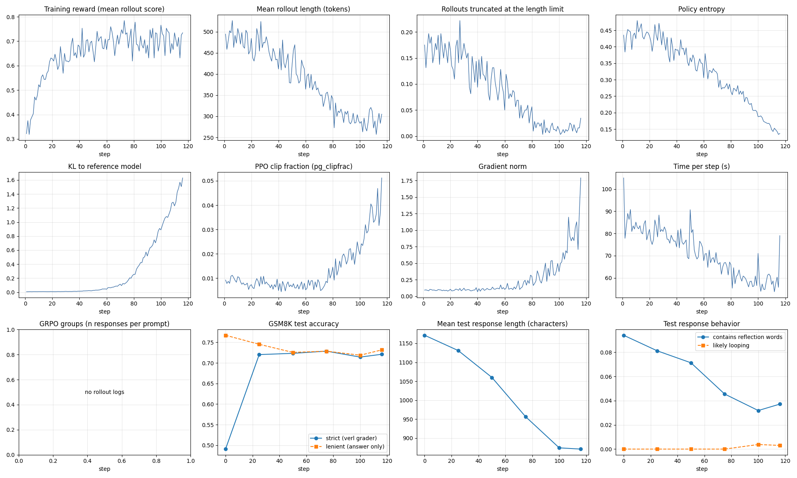

# GRPO on a Budget: LoRA RL Post-Training of Qwen3.5-2B with verl

A small, self-contained study of RL post-training for a language model on **one rented GPU**. The project trains a LoRA adapter on [Qwen3.5-2B](https://huggingface.co/Qwen/Qwen3.5-2B) with GRPO (the RL algorithm used in DeepSeek-R1) using [verl](https://github.com/verl-project/verl), then compares model behavior and evaluation scores before and after training on GSM8K and AIME 2026.

The goal was not a leaderboard number. The goal was to run the full pipeline end to end, and to check whether the "aha" behavior described in the DeepSeek-R1 paper (longer responses, self-reflection) shows up at this scale, and why or why not.

Full results, tables, and logs: **[results/README.md](results/README.md)**.

## Key findings

1. **The reward gain was format, not reasoning.** One epoch of GRPO raised strict GSM8K accuracy from **49.1% to 72.0%**. But verl's grader requires `#### <number>` with a space, and the base model often wrote `####17` or `#### $18`. Judged on the answer alone, accuracy actually went from **75.8% to 73.1%**. The model learned to satisfy the grader within ~25 steps and spent the rest of training compressing its answers.
2. **No R1-style "aha" moment at this scale.** Instead of growing, responses got shorter (486 → 288 tokens), policy entropy fell (0.43 → 0.14), and KL to the base model rose from 0.007 to 1.5. On AIME, responses that loop until the length limit rose from 7% to 30%.
3. **In thinking mode, the bottleneck is the token budget.** With Qwen3.5's thinking mode on and an 8192-token limit, the model solved **95%** of the GSM8K problems it finished reasoning about, but **29%** of responses were still thinking when cut off. On AIME, none of 240 responses finished within 8192 tokens. GSM8K is too easy to teach this model new problem-solving; the remaining headroom is format and reasoning length.



*Run 1 (thinking off): reward saturates early while entropy keeps falling and KL keeps rising. The bottom-middle panel shows strict vs. lenient accuracy: the gap closes, but lenient accuracy does not go up.*

## Setup

| | |
|---|---|
| Model | Qwen3.5-2B, LoRA rank 32 / alpha 32 (the base model stays frozen) |
| Algorithm | GRPO: 64 prompts × 5 responses per step, lr 3e-6, KL loss coefficient 0.001 |
| Framework | verl, pinned to commit `b17218b`; vLLM for generation, FSDP2 for training, Ray for orchestration |
| Data | GSM8K train/test (1319 test problems); AIME 2026 (30 problems) for evaluation |
| Hardware | 1 × NVIDIA L40S 48 GB on RunPod, ~$1.09/h |
| Cost | Run 1 (training + evaluation) took ~5.3 h, about $6 |

## Repository layout

| Path | Purpose |
|---|---|
| `scripts/common.sh` | All paths, the pinned verl version, and default hyperparameters (the single source of truth) |
| `scripts/setup_pod.sh` | Installs the environment on a fresh Pod |
| `scripts/prepare_data.sh` | Downloads the model and prepares GSM8K and AIME 2026 |
| `scripts/prepare_aime26.py` | Converts AIME 2026 into verl's parquet format |
| `scripts/smoke_test.sh` | Small trial run (4 steps) to check that everything works |
| `scripts/eval.sh` | Evaluation only, for the baseline or a trained checkpoint |
| `scripts/train.sh` | Full GRPO training |
| `scripts/cleanup.sh` | Kills processes left over from a failed run |
| `scripts/group_stats.py` | Per-step GRPO diagnostics from training rollouts |
| `scripts/analyze_generations.py` | Before/after analysis, failure categories, and training curves |
| `results/` | Experiment log, cleaned logs, and evaluation outputs |

The shell scripts are thin wrappers: they set hyperparameters and call verl's own training entry point (`verl.trainer.main_ppo`) with Hydra overrides. verl provides the GRPO implementation and the rule-based graders for GSM8K and AIME.

## Diagnostics

The two analysis scripts are where most of the findings came from.

- **`group_stats.py`**: GRPO normalizes rewards within each group of responses to the same prompt. If a group is all correct or all wrong, every response gets zero advantage and the prompt contributes nothing to the update. For each training step the script reports the share of all-wrong / all-correct / mixed groups, pass@n, response length for correct vs. wrong answers, likely repetition loops (detected by compression ratio), and, in thinking mode, how often thinking was cut off. It can run on the Pod during training:
  ```bash
  python3 scripts/group_stats.py /workspace/logs/rollout_generations/<experiment> --last 5
  ```
- **`analyze_generations.py`**: classifies every GSM8K response (correct, right answer with a rejected format, truncated, etc.), reports **strict** accuracy (verl's grader) next to **lenient** accuracy (answer only), counts per-problem flips, reports AIME mean@k / pass@k, and draws the 12-panel training-curve figure above:
  ```bash
  python scripts/analyze_generations.py results/run1            # thinking off
  python scripts/analyze_generations.py results/<dir> --think   # thinking on
  ```

## Reproducing

### 1. Prepare a RunPod GPU

1. Add an SSH public key under **Settings → SSH Public Keys** on RunPod. A dedicated key for RunPod is recommended.
2. Optionally create a Network Volume (~100 GB) in a datacenter with L40S availability, so data survives Pod termination.
3. Deploy a Pod: 1 × L40S (any 48 GB GPU should work), On-Demand, RunPod PyTorch template, 40 GB container disk. If there is a CUDA filter, pick 13.0 or newer.
4. Connect with the **SSH over exposed TCP** command from the Connect tab.

### 2. Get the code onto the Pod

```bash
cd /workspace
git clone https://github.com/megumidaisiki/AgentRL.git
cd AgentRL
```

### 3. Run

Install the environment first (this also installs tmux), then work inside tmux so jobs survive SSH disconnects:

```bash
bash scripts/setup_pod.sh
tmux new -s train
```

Reattach later with `tmux attach -t train`. Inside tmux, run in order:

```bash
bash scripts/prepare_data.sh
bash scripts/smoke_test.sh
bash scripts/eval.sh gsm8k
bash scripts/eval.sh aime26
bash scripts/train.sh
```

After training, evaluate the checkpoint:

```bash
CHECKPOINT=/workspace/ckpts/<experiment>/global_step_<step> bash scripts/eval.sh gsm8k
CHECKPOINT=/workspace/ckpts/<experiment>/global_step_<step> bash scripts/eval.sh aime26
```

Running `train.sh` again with the same `RUN_NAME` resumes from the latest checkpoint; use a new name to start fresh. Any setting can be overridden with environment variables (see `scripts/common.sh`) or extra Hydra arguments, e.g. `TOTAL_EPOCHS=2 bash scripts/train.sh data.train_max_samples=1500`.

**Thinking mode.** Every script accepts `THINKING=1`, which passes `+data.apply_chat_template_kwargs.enable_thinking=True` to verl (the leading `+` is required because the key is not in verl's base config). It also raises the response limits (4096 for GSM8K, 8192 for AIME), switches validation to the model card's recommended sampling (temperature 1.0, top_p 0.95, top_k 20), and samples each AIME problem 8 times. Training and evaluation must use the same mode. Run `THINKING=1 bash scripts/smoke_test.sh` first after switching.

### 4. Copy results back and shut down

From your local machine (port and IP are on the Connect tab):

```bash
scp -P <port> -r root@<ip>:/workspace/logs ./results/
```

Then terminate the Pod. A Network Volume, if used, keeps its data and keeps billing for storage until deleted.

Exporting the LoRA adapter to a standard format has **not been verified**; it is unclear whether verl's merger supports the `fsdp2` checkpoints used here:

```bash
cd /workspace/verl
uv run --frozen --all-packages --extra vllm --extra fsdp python -m verl.model_merger merge --backend fsdp --local_dir /workspace/ckpts/<experiment>/global_step_<step>/actor --target_dir /workspace/export/<experiment>
```

## Troubleshooting

- **`$'\r': command not found`**: the scripts were checked out with CRLF line endings. Run `sed -i 's/\r$//' scripts/*.sh` on the Pod.
- **Out of RAM or GPU memory when re-running after a failure**: processes from the previous run may still be alive. Run `bash scripts/cleanup.sh` first. It kills all verl jobs, so do not run it while training.
- **The job hangs silently with an idle GPU**: on Pods with few CPU cores, Ray actors wait forever for CPUs. `scripts/common.sh` already reduces the actor counts and sets `num_cpus=32`; see the troubleshooting table in `results/README.md`.
- **GPU out of memory**: lower settings step by step, e.g. `ROLLOUT_GPU_MEM_UTIL=0.25 TRAIN_BATCH_SIZE=32 ROLLOUT_N=4 bash scripts/train.sh`. 24 GB GPUs did not work for this setup.
- **torch cannot see the GPU**: `nvidia-smi` may report a CUDA version older than 13.0. Redeploy on a different machine.
- **`uv` or `tmux` missing after a Pod restart**: run `setup_pod.sh` again; data in `/workspace` does not need to be downloaded again.

## Caveats

- GSM8K prompts ask for `####` and AIME prompts ask for `\boxed{}`; the two use different graders.
- AIME 2026 has only 30 problems (~3.3 points each). A single greedy run is very noisy: two identical baselines scored 4/30 and 1/30. Read it together with GSM8K and the actual responses.
- All results come from single runs on one GPU type with no repeated seeds.
- Training used much shorter response limits than the model card recommends (32768 tokens), because of budget.

## Acknowledgements

Built on [verl](https://github.com/verl-project/verl) and [Qwen3.5](https://huggingface.co/Qwen/Qwen3.5-2B). The method follows GRPO as described in DeepSeekMath and DeepSeek-R1.
