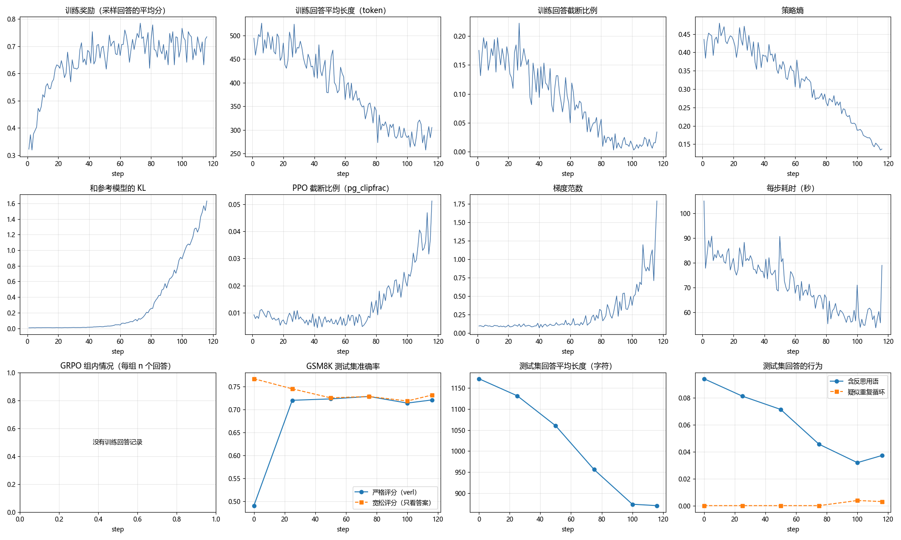

# 实验记录

这里只放小文件：日志、分数和样例输出。每次实验记一行。所有结果都在 L40S 48GB 上得到。

| 日期 | 实验名 | 配置 | GSM8K | AIME 2026 | 备注 |
|---|---|---|---|---|---|
| 2026-11-08 | smoke | 64 条训练、32 条验证，4 步 | 34.4% → 43.8%（32 题，无参考价值） | — | 流程跑通，稳定后每步约 25 秒 |
| 2026-11-08 | eval-*-baseline（第一次） | 无训练 | 48.4% | 13.3%（4/30） | 没有保存回答 |
| 2026-11-09 | eval-*-baseline（第二次，保存回答） | 无训练 | **49.1%** | **3.3%**（1/30） | 作为训练前的对照 |
| 2026-11-09 | gsm8k-r32-e1 | 1 个 epoch，116 步，约 2.5 小时 | 49.1% → 72.0% | — | 训练中的验证 |
| 2026-11-09 | eval-*-trained（第 116 步） | 加载训练后的 LoRA | **72.0%**（严格）／ 73.1%（宽松） | **3.3%**（1/30） | 涨分几乎全部来自格式，详见下文 |

共同设置：verl `b17218b`，Qwen3.5-2B，LoRA rank 32 / alpha 32，关闭思考模式，验证时贪心解码、每题只生成一次回答。GSM8K 回答上限 1024 token，AIME 4096 token。

- 2026-11-08 的试跑和第一次基线日志在 [`l40s/`](l40s/)。
- 2026-11-09 的训练、训练前后评测的日志和评测回答在 [`run1/`](run1/)。训练中每 25 步的验证回答（约 11 MB）只保存在本地，没有提交。
- 日志已去掉 Ray 的 DEBUG 输出，时间为 UTC。
- 分析脚本：`python scripts/analyze_generations.py results/run1`，会打印下面的表格并重新生成训练曲线。

## 第一次正式训练（gsm8k-r32-e1）

设置：GRPO，每步 64 题 × 5 个回答，1 个 epoch（116 步），学习率 3e-6，KL 损失系数 0.001（`low_var_kl`）。训练约 2.5 小时，加上训练后评测共约 5.3 小时，L40S 每小时 $1.09。

### 主要结论：分数上涨几乎全部来自格式

verl 的 GSM8K 评分规则只认 `#### 数字`，**井号后必须有空格**。基线模型很多回答写成 `####17` 或 `#### $18,000`，答案对了也记 0 分。

| 类别（1319 题） | 训练前 | 训练后 |
|---|---|---|
| 答对（严格评分） | 647 | 950 |
| 答案对，但格式不符合规则 | 349 | 0 |
| 没写 `####`，但最后的数字对 | 4 | 14 |
| 格式对，答案错 | 171 | 333 |
| 格式不对，答案也错 | 86 | 2 |
| 没写 `####`，答案错 | 28 | 12 |
| 没写 `####`，疑似被截断 | 34 | 8 |
| **严格准确率（verl 评分）** | **49.1%** | **72.0%** |
| **宽松准确率（只看答案）** | **75.8%** | **73.1%** |
| 回答长度（字符，平均 / 中位数） | 1158 / 1038 | 866 / 793 |
| 含反思用语（wait、verify 等）的回答 | 9.2% | 3.7% |

- 训练前 25 步内，严格准确率就从 49% 跳到 72%，同时"格式不合规则但答案对"从 365 题降到 33 题。之后 90 步，严格准确率基本不动。
- 只看答案本身，准确率从 75.8% 略降到 73.1%：103 题从错变对，139 题从对变错。**模型并没有算得更准。**
- 变错的题里，常见情况是推理被压缩、漏掉条件。例如一题的标准答案是 36，训练前算对，训练后漏乘"每周 3 次"，答成 12。

### 训练中的验证（GSM8K 测试集）

| step | 严格准确率 | 宽松准确率 | 格式不合规则但答案对 | 疑似截断 | 平均长度（字符） | 反思用语 |
|---|---|---|---|---|---|---|
| 0 | 49.1% | 76.7% | 365 | 41 | 1171 | 9.4% |
| 25 | 72.0% | 74.5% | 33 | 35 | 1131 | 8.1% |
| 50 | 72.3% | 72.6% | 3 | 32 | 1060 | 7.1% |
| 75 | 72.9% | 72.9% | 0 | 16 | 957 | 4.5% |
| 100 | 71.4% | 71.9% | 6 | 10 | 874 | 3.2% |
| 116 | 72.1% | 73.2% | 14 | 9 | 871 | 3.7% |

### 训练动态

| 指标 | 前 5 步 → 最后 5 步 | 解读 |
|---|---|---|
| 训练奖励 | 0.36 → 0.70 | 主要在前 30 步上涨，对应学会格式 |
| 回答长度（token） | 486 → 288 | 持续变短，和 R1 论文中回答变长**相反** |
| 截断比例 | 17% → 1.7% | 写满 1024 被截断的回答几乎消失 |
| 策略熵 | 0.43 → 0.14 | 持续下降，模型输出越来越确定 |
| 和参考模型的 KL | 0.007 → 1.5 | 第 60 步后快速上升，偏离原模型越来越远 |
| 每步耗时 | 88 秒 → 61 秒 | 回答变短，生成更快 |

- 格式学会以后，奖励就不再上涨，但熵仍在下降、KL 仍在上升。说明后半程主要在**压缩回答**，没有学到新的解题能力。KL 系数 0.001 几乎不起约束作用。
- 继续训练多半会让 KL 继续上升，没有好处。

### AIME

| | 训练前 | 训练后 |
|---|---|---|
| 答对 | 1/30 | 1/30 |
| 没写出 `\boxed{}`（多半写满 4096 被截断） | 26 | 21 |
| 回答平均长度（字符） | 9371 | 8283 |
| 含反思用语的回答 | 96.7% | 76.7% |

- **单次贪心解码的 AIME 分数不能用来比较**：同样在 L40S、同样的设置，两次基线一次 4/30，一次 1/30。vLLM 每次的计算顺序略有不同，在 4096 token 的长回答里差异会被逐步放大。GSM8K 回答短，两次基线只差 8 题（48.4% 和 49.1%）。
- 大部分回答写满 4096 也没写出答案，2B 模型关闭思考模式时，解不了竞赛题。

### 这次实验说明了什么

1. **奖励设计会被模型"钻空子"**：模型最快学会的是满足评分规则的格式，而不是更好的推理。这和 R1 论文里说的格式奖励、准确率奖励要分开设计是同一个道理。
2. **必须同时看严格和宽松两种评分**，否则会把格式改善误认为能力提升。
3. GSM8K 对这个模型太简单（宽松准确率已有 76%），回答上限 1024 也偏短，不会出现 R1 那种回答变长、出现反思的现象。

### 下一步

- 修正评测口径：同时报告严格和宽松两种准确率，或者把提示词改得更明确，让基线不因格式丢分。
- AIME 改成每题采样多次取平均（例如 16 次），减小波动。
- 想观察 R1 现象，需要更难的训练数据（例如 MATH 或 DAPO-Math）、更长的回答上限，并考虑开启思考模式。
- 把 KL 系数调大，或者在奖励开始停滞时提前停止，避免模型过度偏离原模型。

## 附录

### L40S 运行参考

- **试跑耗时（每步 64 个回答）：** 第 1 步 106 秒，其中有预热开销。之后每步：生成约 12 秒，计算旧策略概率约 3 秒，更新参数约 6 秒，合计约 25 秒；保存 checkpoint 约 21 秒。
- **显存：** 训练部分峰值约 17.5 GB，vLLM 另外占用约 30% 显存。
- **GSM8K 评测：** 从启动到结束约 11 分钟，其中启动约 3–4 分钟。
- **回答样例：** 只用控制台日志时，`log_val_generations` 不会打印样例。`scripts/common.sh` 设置了 `trainer.validation_data_dir`，每次验证的全部回答会写到 `/workspace/logs/val_generations/<实验名>/`。
- **评测结束时的 SIGSEGV：** AIME 评测结束时，奖励计算进程可能报 SIGSEGV，出现在指标打印之后，不影响结果。

### 环境排错记录

在找到 L40S 之前试过几种显卡，遇到的问题和解决方法：

| 现象 | 原因 | 解决 |
|---|---|---|
| RTX 4090：vLLM 报 `No available memory for the cache blocks` | 24 GB 显存下，默认 `ROLLOUT_GPU_MEM_UTIL=0.3` 只给 vLLM 约 7 GB | 调高该值并开启 offload 后，又遇到下一行的内存不足 |
| RTX 4090：Ray 报内存不足（`OutOfMemoryError`） | Pod 内存上限约 38 GB，offload 把参数放进内存后超限 | 换成 48 GB 显卡 |
| 失败后重跑，内存或显存莫名不够 | 上次失败运行留下的进程没有退出，占用约 10 GB 内存 | 重跑前运行 `scripts/cleanup.sh` |
| 48 GB 显卡：计算熵时 `CUDA out of memory` | Qwen3.5 词表很大；`use_remove_padding=False` 时不会分块计算熵，整块 logits 一次性展开 | 改为 `use_remove_padding=True`，开启分块计算熵，每卡 token 上限设为 6144（已写入 `scripts/common.sh`） |
| A40（7 核 CPU）：试跑启动 5 分钟后日志不再更新，GPU 一直空闲，`ray status` 显示 CPU 7/7、GPU 0/1 | verl 默认开 8 个 TransferQueue 存储进程、8 个奖励进程和 8 个 rollout 调度进程，Ray 给每个分 1 个 CPU，CPU 不够时进程一直排队、不报错 | 在 `scripts/common.sh` 中把三类进程数都设为 2，并设 `ray_kwargs.ray_init.num_cpus=32` |
